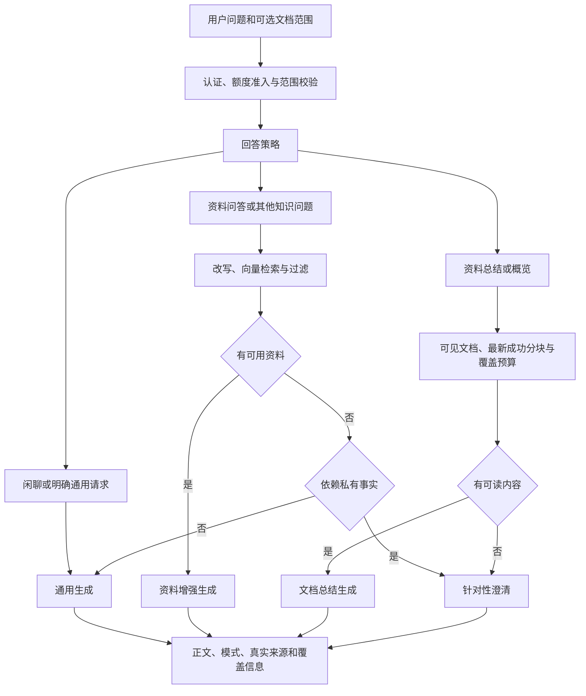

# 自适应 RAG 回答策略设计

## Context

问题背景见 proposal.md。当前 `SearchService` 把改写、Embedding、相关性过滤、生成和响应缓存串成单一路径；零向量、零命中提前返回。前端直接持久化 SearchResponse，旧记录没有回答模式。认证与额度准入已经统一在 `/api/search`，本次继续复用。

## Goals / Non-Goals

**Goals:** 在现有问答入口建立可测试的回答策略，按语义需要使用私有资料；推荐总结问题能读取真实文档，通用问答不依赖知识库命中。保持现有用户、模型配置及资料可见性边界。

**Non-Goals:** 不增加单独聊天入口、模型分类请求、流式协议、会话数据库或新的资料选择界面；显式范围通过可选 API 字段支持，默认总结当前用户的可见资料。完整层级摘要与超大知识库的跨请求摘要持久化不在本次范围。

## Decisions

### 1. 复用入口，分离策略与上下文读取

- `answer_policy.py` 负责不依赖模型供应商的意图判定与各模式提示词，优先顺序为明确文档意图、明确闲聊/通用请求、其他知识问题。不能把“总结 Python 装饰器”误判成私有文档总结；总结须同时有资料指代。包含资料指代的“你好，帮我总结资料”走资料分支。
- `summary_context.py` 负责按用户读取文档与最新成功分块、读取外置正文、选择有界内容、返回来源和覆盖统计。复用现有模型表，不依赖向量相似度、Embedding 或重排服务。
- `SearchService` 保留统一编排、缓存、生成降级及审计。生成逻辑接受回答模式，普通空上下文也调用 ChatAdapter；资料专属问题的澄清不调用模型。
- 选择轻量确定性路由，避免每条问题增加一次 LLM 分类调用与费用。更复杂的问题先尝试资料检索，零命中仍能回答；后续可替换策略模块，不改变接口。

### 2. API 与兼容性

请求增加 `document_ids: list[UUID] | None`，给定时 1–20 项，先去重再校验所有资源。范围过滤同时用于检索 SQL、计数和总结 SQL。不可见资源统一 404，并给出“指定资料不存在或不可访问，请重新选择资料”，不暴露实际归属。

响应增加：

| 字段 | 值与用途 |
| --- | --- |
| `answer_mode` | `general`、`rag`、`summary`、`clarification` |
| `retrieval_status` | `skipped`、`matched`、`no_match`、`empty`、`unavailable` |
| `summary_coverage` | 非总结为 null；总结为文档数、实际覆盖文档数、总分块数、选取分块数与 `truncated` |

保留旧诊断字段和 SearchResult 结构。跳过向量检索时 `query_embedding_preview=[]`、`total_searched=0`，`embedding_model/dimensions` 仅表示配置，不能解读为发生调用。总结来源的 `score` 仅为兼容占位，前端按 summary 模式不渲染分数图，`rank` 是上下文顺序。总结不由 `top_k` 截掉整份文档，改用单独覆盖预算。

前端类型把新增响应字段设为可选，以兼容已有 localStorage 记录。新服务总是返回它们。未带模式的旧记录继续原展示；不根据 `results=[]` 猜测旧答案是通用回答。

### 3. 回答与提示词边界

通用模式允许模型解释、举例和正常交流，禁止虚构“资料说”、文档名、页码和引用。有资料的模式优先从资料回答，可以加明确标注的通用知识解释；资料没有支持的私有事实不能靠通用知识补齐。历史消息仅保留 user/assistant，沿用现有单条长度保护，不授予历史答案新的证据地位。

资料专属问题零召回时提供明确原因和上传/选择资料的引导。Embedding API 失败与无结果分开表达：普通问题 `general/unavailable`，私有事实问题说明检索暂不可用。数据库或权限错误不吞掉；不得降级到其他身份。保留 ChatAdapter 现有重试、首 token 超时、整体超时和熔断行为，未配置模型仍返回可读 503。生成失败保留 `generation_error`，不显示为成功答案。

### 4. 总结范围、文本与预算

显式范围优先；未给范围时取当前用户源文件未删除的文档。没有可读资料时提示上传或等待处理；超过 20 份时先让用户缩小范围。小资料读取全部有效分块；每份文档只使用最新成功分块任务，避免重分块重复。正文外置时通过现有存储设置读取，工件失败返回可读服务错误，不能静默丢弃。

本轮资料正文总预算为 60,000 字符，按文档分配并保持每份资料有代表内容，单分块超限时截取并标记。`total_chunks` 统计范围内最新成功版本的有效片段，`included_chunks` 统计实际提供的片段；任何片段未完整覆盖都设 `truncated=true`，提示词与 UI 同时披露。来源保留真实 chunk/document ID、文件名、页码和标题路径。此方案提供有界概览；大资料不声称阅读全文。

### 5. 缓存、额度与生命周期

总结缓存还包含可见文档与最新成功分块版本签名，使未向量化资料的新增、删除、重分块也能失效。响应缓存作用域加入回答策略版本及排序去重后的文档范围，同时保留已认证用户、知识库指纹、模型配置版本、会话和历史摘要。通用成功回答可以缓存并按既有规则计额；`unavailable` 和模型失败不缓存，避免故障恢复后仍使用旧降级结果。澄清不计额，`admission.succeeded` 必须排除 clarification。

不新增后台任务、持久连接或线程。数据库 session 与外部客户端仍由请求依赖创建和释放；存储正文使用有界文件读取，文件句柄随读取结束关闭。现有停机协调器仍拒绝新工作并释放在途客户端，本次新增纯策略与上下文对象不持有跨请求资源；不可捕获的 SIGKILL/宿主机崩溃沿用现有恢复边界。

### 6. 前端展示

`general` 显示正文、复制、真实 token 和轻量“基于通用知识”，不挂空 SourceList 或检索详情。`unavailable` 另行说明检索暂不可用。`rag` 保留来源与诊断，通用补充不伪造引用。`summary` 显示总结范围及真实来源，部分覆盖时说明“基于部分资料总结”，省略语义分数图。`clarification` 只展示引导，不显示零引用、来源告警或虚假用量。欢迎文案和输入区说明同步表达“可直接提问，上传资料增强回答”。

## Risks / Trade-offs

- 规则路由存在边界 → 参数化覆盖中文/英文问候、概览、普通总结与明确资料请求；未知问题先尝试检索并允许通用兜底。
- 通用补充可能被误认为文档事实 → 模式标注、提示词归属规则、来源只使用真实选取的资料；不承诺模型自动事实核验。
- 有界总结可能遗漏细节 → 返回可测的覆盖统计，UI 与 prompt 明确披露部分覆盖。
- API 旧测试把 404/固定拒答当预期 → 在 GREEN 阶段更新行为断言，保留跨用户隔离及故障保护断言，不靠删除测试隐藏回归。

## Migration Plan

无数据库迁移和新依赖。完成 TDD 评审与 GREEN 后先部署兼容新增字段的前端，再部署后端；策略版本隔离旧响应缓存。回滚使用原代码，浏览器旧记录仍可读。不在本次自动部署、清空用户会话或改动演示额度。

## Validation

RED 使用真实 SearchService、真实 SQLite 资料和认证；只替换模型/Embedding 网络边界与 SQLite 不支持的 pgvector 检索。前端用真实组件与 Pinia，只替换 API。测试覆盖普通问答、空库、零命中、资料澄清、多文档总结、范围/删除/重分块、工件、预算、故障、缓存和额度。

GREEN 后运行后端 `uv run ruff check .`、`uv run ruff format --check .`、`uv run pytest`；前端 `npm run lint`、`npm run test`、`npm run build`。浏览器验证普通回答无空来源告警、真实来源可展开、总结覆盖和错误可见。外部模型实测需使用可用测试配置，不能用替身声称线上效果已经通过。

## 回答完整性修正（2026-10-26）

用户截图表明资料已进入总结上下文，但正文仅输出开头。代码未保留供应商 `finish_reason`，非空的截断正文会被当作成功、计额并缓存。截图本身不能证明供应商实际以何种原因结束。

- ChatAdapter 同步和流式返回保留 `finish_reason`；流正常耗尽但没有结束标记时使用 `stream_interrupted`，不能当作正常结束。流在成功、失败与取消时均关闭。
- SearchService 遇到 `length` 最多自动续写两次，每次保留原资料、原始问题和已生成正文，要求仅接续未完成内容。正常 `stop` 不增加调用；过滤或中断不自动续写。合并正文并累计每次实际 token 用量，继续遵循既有来源边界。
- 新增响应 `answer_incomplete: bool=false`，与输入侧 `summary_coverage.truncated` 独立。续写耗尽、后续失败、超时或非正常结束仍有正文时保留正文和来源，设为 true，不缓存、不计成功额度。完全没有正文时沿用原生成失败路径。兼容旧本地对话缺少该字段。
- 所有生成与续写共用 `CHAT_GENERATION_TIMEOUT` 总截止时间（默认 120 秒），保留首 token 和 HTTP 超时；403 合并消息重试也计入同一截止时间。默认 `CHAT_MAX_TOKENS` 从 1024 调为 4096；已有环境显式覆盖保持优先，发布时须核对实际值。正常生成加最多两次续写，另保留原有网络重试和一次 403 合并消息重试，预算与成本有界。
- UI 在不完整正文之前提示“回答尚未完成”，建议缩小问题或继续提问。覆盖文案改为“已提供给模型”，不再暗示正文已经完整覆盖全部资料。普通完整答案不增加告警。
- 不修改数据库或线上配置，不部署。测试覆盖真实 SSE 格式、正常结束、长度结束、缺失结束、续写合并及用量、续写失败/超时/上限、缓存、额度和旧界面兼容。
