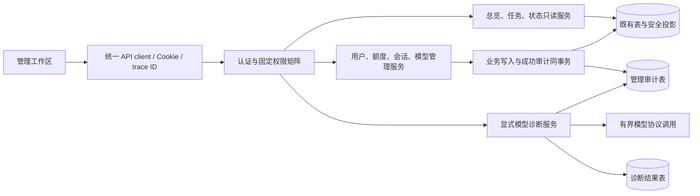

# 知寻后台管理改版设计

## Context

### 现状与依据

本方案基于当前工作区，而非通用后台模板。已阅读 `AdminFrame.vue`、两张管理页面、管理 API、用户/模型/限额/任务模型以及 `add-admin-console` 设计与规范。当前用户管理、模型配置已实现；工作区存在对旧页面和旧变更工件的未提交调整，本次仅新增方案文件。

| 现有能力 | 现有不足 | 本次处理 |
| --- | --- | --- |
| 新增用户、角色、启停、重置密码、软删除 | 无服务端搜索、组合筛选和账号运行详情 | 搜索列表、详情抽屉、额度与会话控制 |
| 四用途模型配置、加密密钥、默认绑定、环境回退 | 缺少生效配置全貌，保存后不知道连接是否可用 | 四用途概览、来源与版本、显式测试 |
| 解析、分块、向量化任务各自持久化 | 管理员没有跨阶段运行视图 | 只读任务台账与安全故障分类 |
| structlog、trace ID、改写 AuditTrail | 日志流未形成可查询的管理操作台账 | 新增独立管理审计表 |
| 用户最近 60 分钟问答限制 | 主要通过 CLI 建号时配置，数据非历史用量账本 | 后台查看与调整额度，明确占用口径 |
| `/api/health` 与文档模型准备状态 | 不等同于数据库、pgvector 和模型服务全面健康 | 管理员诊断页与状态时间戳 |

### 模块边界与数据流



业务主链继续为：用户资料 → 解析 → 分块 → 用户作用域索引；用户问题 → 改写 → 检索 → 重排 → 生成 → 原文片段与引用。管理页观察状态和维护配置，不读取这条链路中的他人资料正文、查询、提示词、回答、向量或引用内容。

## Goals / Non-Goals

**目标**：管理员可在总览定位异常，进入账号、模型或任务页查明运行原因，再通过既有安全管理操作处理，并在审计页追溯变更。常见操作提供清晰的对象、影响范围、执行状态和失败恢复入口。

**本次实施范围**：六个管理页面及所需接口、数据库增量与测试。保持三种固定角色，不增加资料代管能力。

**后续独立规划**：完整用量与费用、存储配额、检索质量评测、版本化 RAG 参数、告警通知、团队空间、自定义角色、索引迁移及任务重试/取消。首期不展示没有数据来源的费用、在线人数、历史请求趋势或准确任务进度百分比。

## Decisions

### 1. 信息架构与优先级

以平台运行管理为默认场景，首期功能按下面顺序落地。A/B/C 是同一变更的三个交付阶段，全部属于首期；后续增强需新建变更。

| 页面与路由 | 页面职责 | 首期关键功能 | 阶段 |
| --- | --- | --- | --- |
| 运行总览 `/admin/overview` | 判断系统是否可用、哪里需要处理 | 账号/资料统计、分阶段任务计数、待处理异常、四用途模型状态、最近管理操作 | B/C 完成后接入真实数据 |
| 用户管理 `/admin/users` | 维护账号及访问能力 | 邮箱/名称搜索、角色/状态筛选、详情、原有生命周期操作、滚动额度、退出所有设备 | A |
| 模型服务 `/admin/models` | 明确“现在用了什么，能否调用” | 四用途生效卡片、配置列表、来源/版本、配置编辑、显式测试、默认切换影响说明 | B |
| 处理任务 `/admin/jobs` | 判断资料处理卡在哪一环 | 解析/分块/向量化统一列表、筛选、阶段时间线、耗时、安全错误码 | C |
| 操作审计 `/admin/audit` | 追溯谁在何时改变了什么 | 时间/操作者/动作/结果/trace ID 筛选、变更前后白名单字段 | A 建底座，C 完成页面 |
| 系统状态 `/admin/system` | 区分依赖故障与业务问题 | 数据库、pgvector、文档模型就绪状态、有效配置来源、检查时间、手动刷新 | C |

`/admin` 进入总览；原 `/admin/users`、`/admin/models` 直达地址继续可用。保留返回知识书房和账户入口。

### 2. 页面布局与视觉

沿用“书房批注本”视觉：paper 背景、surface 内容面、ink 文字、brand 主操作；引用语义继续使用 cite。健康状态优先采用图标加文字，颜色使用现有令牌或经对比度验证后新增的语义令牌。选择扩展现有组件，避免引入整套后台框架改变项目风格。

桌面侧栏约 224px，页头展示面包屑、标题、说明和主操作。主区域随屏宽扩展，内容上限约 1440px。数据表承载比较，详情放右侧抽屉；每页主要按钮最多两个，高风险操作收进明确标注的操作区。

```text
┌───────────────────────────────────────────────────────────────────┐
│ 知寻 · 管理后台       管理后台 / 运行总览        返回知识书房  账户 │
├───────────┬───────────────────────────────────────────────────────┤
│ 运行总览  │ 运行总览                   数据截至 …      [刷新]     │
│ 用户管理  │ [账号数量] [资料数量/容量] [排队] [失败任务·24h]       │
│ 模型服务  │                                                       │
│ 处理任务  │ 需要关注                          模型用途            │
│ 操作审计  │ · 向量化失败 … [查看任务]         对话      环境配置   │
│ 系统状态  │ · 文档模型未就绪 [系统状态]       Embedding 后台默认   │
│           │                                  重排      未启用     │
│           │                                  查询改写  后台默认   │
│           │                                                       │
│           │ 分阶段任务摘要                    最近管理操作        │
│           │ 解析 / 分块 / 向量化              谁 / 动作 / 时间     │
└───────────┴───────────────────────────────────────────────────────┘
```

图中仅为字段布局，不代表已有统计结果。概览卡片点击后进入带相应筛选条件的列表；总览不放高风险快捷按钮。

用户页交互示意：

```text
用户管理                                             [新增用户]
[搜索邮箱或名称…] [角色：全部] [状态：全部] [重置筛选]
账号             角色       状态       创建时间         操作
张同学 / 邮箱    成员       正常       …                [查看] […]

┌─ 用户详情 ────────────────────────────────────────┐
│ 基本资料：邮箱、显示名、角色、状态、创建时间      │
│ 访问与额度：有效会话数、最近 60 分钟占用/限制     │
│ [修改角色] [调整问答额度] [退出所有设备]          │
│ 危险操作：[重置密码] [禁用账号] [删除账号]        │
└──────────────────────────────────────────────────┘
```

模型页先展示四用途卡片，再展示配置库；明确区分“已启用”“当前默认”“环境来源”“最近测试”。表单分基本配置与高级选项，保留密钥留空不变、显式清除规则。配置错误、未测试、测试失败和配置已变更分别展示。

任务页采用“筛选栏 → 列表 → 详情时间线”：任务类型、任务 ID、所属账号、阶段状态、创建/开始/结束时间、耗时和错误分类。资料引用只展示内部上传 ID，不展示原文件名或正文。尚未产生下一阶段任务时显示“尚未创建”，不推断其失败。

小于 768px 时侧栏改为抽屉、详情全屏、筛选可折叠；列表转为字段明确的卡片，主要操作保留文字。320px 下页面不横向溢出。抽屉、确认框支持焦点循环、Esc 关闭最上层及焦点归还；当前页导航和状态变化有读屏语义。

### 3. 统一交互约定

- 查询筛选由服务端执行；输入搜索防抖 300ms，筛选变化回到第一页，页大小默认 20、最大 100。过期请求不得覆盖新结果，抽屉只加载当前对象。
- 筛选和分页可写入站内 URL，秘密及原始查询内容不得进入 URL。账号搜索词只存页面内存，刷新后重置；不把邮箱搜索词写入 URL 或浏览器持久存储。
- 首次加载显示骨架，刷新保留上一份数据并标记更新时间；失败明确标记旧数据。未知显示“无法获取”，真正没有数据才显示 0。
- 新增/编辑为表单抽屉，成功反馈并刷新当前筛选；筛选不匹配时说明“已保存，当前筛选下不可见”。提交期间禁用对应动作，不冻结无关页面。
- 重置密码、禁用、删除、撤销会话、变更默认模型和收紧额度说明目标及影响，确认前不执行。删除要求输入目标邮箱确认；无邮箱旧账号改为输入完整账号 UUID，并使用对应标签，不以可重复显示名称确认。账号仍软删除，资料与邮箱占用保留。
- 密码与密钥只在组件内存；关闭、成功和卸载时清空。后端错误映射为可读原因，并提供复制 trace ID；不输出原始请求体或上游响应体。

### 4. 权限与运行元数据边界

| 权限 | 首期角色 | 可访问范围 |
| --- | --- | --- |
| `users:manage` | admin | 账号、会话计数与撤销、该账号额度 |
| `models:manage` | admin | 模型配置、有效来源、显式测试 |
| `operations:read` | admin | 总览、跨账号安全任务元数据、系统状态 |
| `audit:read` | admin | 管理审计，不含业务资料内容 |

继续固定角色矩阵，不开放权限编辑器。页面权限不足时不发管理请求；API 必须独立检查权限和 Cookie 来源。新管理员统计接口是显式命名空间内的最小运维投影；原资料计数、读取、检索、指纹与缓存仍严格使用认证用户作用域。

任务与统计只允许 ID、账号标识、阶段、计数、字节数、时间、模型配置 ID 与安全错误码。禁止返回文件名/标题、存储路径、chunk、向量、查询、回答和未清洗的 `error_message`。已软删除账号不进入总览有效账号/资料统计；历史任务可保留，所属账号显示“已删除账号”。

### 5. API 契约

所有路径以 `/api` 为前缀。除特别说明外成功读取为 200，分页沿用 `{items,total,offset,limit}`；错误沿用 `{code,detail}`，422 不回显秘密输入。既有写接口和响应保持兼容。

| 接口 | 输入与响应要点 |
| --- | --- |
| `GET /admin/overview` | `snapshot_at, users, uploads, jobs_by_kind, attention_items`；每类任务独立给出计数及 24h 成败统计 |
| `GET /admin/users` | 新增 `q`（邮箱/显示名，最多 100 字符）、`role`、`status`；大小写不敏感字面子串匹配，转义通配符，组合 AND；默认行为兼容既有接口 |
| `GET /admin/users/{id}` | `user, active_session_count, chat_limit`；删除或不存在为 404 `user_not_found` |
| `GET /admin/users/{id}/chat-limit` | `hourly_limit, occupied_slots, remaining, window_seconds:3600, observed_at`；不限额时前三项为 null |
| `PUT /admin/users/{id}/chat-limit` | `{hourly_limit: null 或 1..100000 整数}`；null 为不限额，成功返回额度快照 |
| `POST /admin/users/{id}/revoke-sessions` | 空请求体；`{revoked_count}`；重复执行成功且可为 0；自身为 409 `cannot_revoke_self_sessions`，引导账户页 |
| `GET /admin/models/effective` | 四用途数组，`source:profile/environment`、`enabled`、`profile_id`、安全模型名、绑定版本、最近测试摘要；不返回环境秘密 |
| `POST /admin/models/{id}/test` | `{expected_revision}`，仅测试已保存的配置；返回 `probe_id,status,code,detail,latency_ms,checked_at,config_revision,is_current` |
| `GET /admin/jobs` | `kind,status,owner_user_id,from,to,offset,limit`；返回统一白名单字段；默认最近 24h，时间按任务创建时间过滤 |
| `GET /admin/jobs/{kind}/{id}` | 该任务安全字段及同一上传关联的三阶段任务元数据；找不到为 404 `admin_job_not_found` |
| `GET /admin/audit-events` | `from,to,actor_user_id,action,result,trace_id,offset,limit`；返回脱敏事件，默认最近 7 天 |
| `GET /admin/system/status` | `checked_at,scope,instance_id,components[]`；组件为 `ok/degraded/unavailable/unknown/disabled`，检查失败不冒充健康 |

用户列表保持既有稳定排序；任务和审计按 `(created_at DESC,id DESC)` 排序。时间统一使用 UTC，`[from,to)`，任务/审计单次范围最长 31 天，非法枚举、反向时间和超大页大小返回有原因的 422。

账号列表按 `(created_at ASC,id ASC)` 排序，q 原始字符数最多 100，匹配前去首尾空白，空字符串/纯空白等同无搜索。邮箱、显示名使用 OR，再与 role/status 及未删除条件使用 AND，先筛选全量再计算分页。列表及详情 user 复用原 UserRead 白名单；详情只另外提供未过期未撤销会话数和滚动额度快照，不修改账号、会话、额度或资料。

新接口无会话为 401 `auth_required`、权限不足为 403 `forbidden`；管理员依赖不可用为 503 `admin_dependency_unavailable`。模型版本冲突为 409 `model_revision_conflict`，测试限流为 429 `model_test_rate_limited` 并带 `Retry-After`。既有 `last_admin`、`embedding_index_conflict` 等错误继续保留。

### 6. 统计口径与系统状态

有效账号为 `deleted_at IS NULL`，状态 active 表示账号允许登录，不等于在线。有效资料为上传记录及所属账号均未软删除；容量为上传原文件 `byte_size` 之和，不包含衍生文件、向量和数据库开销，应标为“原文件逻辑容量”。

任务统计按解析、分块、向量化分开，实时 queued/running 按当前状态计算；最近 24h 成功/失败按 `finished_at` 计算，成功率为 succeeded / (succeeded + failed)，分母为 0 时为 null。阶段成功率不当成整条文档处理链的成功率；无法读取的统计字段为 null 并有状态说明。

“需要关注”来自可证实状态：失败任务、文档模型未就绪、当前模型配置缺失/密钥不可用、最近显式测试失败。长时间 running 只提示“建议检查”，不修改状态、不宣称必然卡死。总览读取配置不请求外部模型；四用途摘要来自生效配置接口，最近操作来自审计接口，局部失败不阻塞其他区块。

系统页以只读查询检查数据库和 pgvector 扩展元数据，每个检查最多 2 秒，总截止时间 5 秒；文档模型复用应用现有 readiness。模型生效来源与最近显式测试通过独立的 `/admin/models/effective` 请求展示，配置读取不进入主动健康检查的截止时间，失败单独提示。进程就绪状态标记 `scope:instance`，不是所有 worker 的集群健康；外部模型只显示最近显式测试，不自动周期调用。数据库完全不可用时 Cookie 认证本身也可能失败，此页面不能取代外部健康监控，不绕开认证提供诊断。

### 7. 问答额度与会话

复用 `user_chat_limits` 与 `chat_usage`，不改现有“失败及生成降级释放，成功含缓存命中计次”的规则。界面用“最近 60 分钟已占用额度（含处理中）”，不称精确成功问答数；预留未释放或进程强杀可能占用到窗口过期。不限额期间不记录完整使用量，因此首次设限不追溯此前的不限额请求。

额度增删和 `reserve_chat` 必须先取得相同的、按 user ID 稳定映射的 PostgreSQL 事务 advisory lock，再读取/锁定限额行；只锁已有行无法保护从“无行不限额”切换为“有限额”的竞态。涉及账号检查时遵循既有账号管理锁 → 该用户额度锁 → 限额行的顺序，额度预留路径不反向获取账号管理锁。外部调用不持锁。

调整不删除当前窗口的预留：收紧到小于当前占用时，已接纳请求继续，新请求被拒绝，剩余额度按 max(0,limit-used) 展示；放宽后新请求可用。切为不限额不重置未过期记录，重新设限时仍计算幸存的旧预留；不限额请求不追溯补记。不增加“清空额度”按钮。

会话撤销使用既有撤销服务，不改变密码、角色和资料。详情只给有效会话数量，不返回 token/hash；撤销他人会话需确认，重新校验操作者，业务写入与审计同事务。

### 8. 模型测试与配置生效

增加模型配置单调递增的 `revision`，与既有用途绑定 `revision` 区分；每次编辑配置递增，既有调用方可忽略这个新增响应字段。有效用途未绑定后台配置时标记环境来源，关闭用途标记 disabled，不列出环境 API Key。

测试是用户显式动作，表单旁说明“会发送少量固定测试内容，可能产生少量费用”。仅接受已保存配置 ID 和期望版本，不接受任意 URL、原始请求体、用户资料或临时密钥；环境来源先保存为后台配置再测试。禁用的已保存配置可测试，测试不启用、不激活、不自动切换默认。

对话/改写使用固定短文本、非流式有界输出；Embedding 使用固定短文本并检查返回向量维度；重排使用固定问题和两段固定样例并验证结果结构。不做真实用户检索或调用完整知识库链路，不把连通性通过等同于回答质量合格。

复用现有适配器协议与错误分类；调用使用可取消的异步传输和请求内客户端。总超时默认 10 秒、不得超过 30 秒，重试为 0；客户端独立于生产请求。禁止把同步阻塞调用放进无法随请求截止而关闭的后台线程。允许既有 loopback/私网服务，但对实际连接校验解析目标，阻止云元数据和链路本地目标，并禁止重定向；DNS 结果必须约束到实际连接，不能只预检查域名。

配置键：`ADMIN_MODEL_TEST_TIMEOUT_SECONDS=10`、`ADMIN_MODEL_TEST_COOLDOWN_SECONDS=30`、`ADMIN_MODEL_TEST_MAX_CONCURRENT=2`；同一数据库支持的多个 worker 共享并发与冷却控制。以短事务串行完成测试准入、写入 running 记录和截止租约，再释放锁执行外部调用；完成后以另一短事务保存结果与审计，不持数据库事务等待网络。

测试执行完毕，无论通过或上游失败，HTTP 200 返回 `status:passed/failed` 及稳定业务码；超时为 `model_test_timeout`，鉴权失败为 `model_test_auth_failed`，连接失败为 `model_test_unreachable`，格式/维度失败为 `model_test_invalid_response`，其余为 `model_test_failed`。准入、权限、版本或密钥错误使用对应 4xx/503，未执行测试不伪造结果。

测试摘要需同时匹配配置版本且在 15 分钟内才算当前参考结果，页面仍显示测试时间；超过时限、测试期间配置改变或已被删除时为过期结果，不据此判断当前可用。停留页面时每秒只更新本地展示时间，不自动重测。成功结果不替代运行时故障处理。新请求仍按既有快照解析默认模型，Embedding 空间限制及缓存版本隔离不变。

### 9. 数据、审计与索引

新增 `admin_audit_events`：`id,actor_user_id,action,resource_type,resource_id,result,changes_json,error_code,trace_id,created_at`。操作者和对象用 UUID 关联，软删除后保留，不复制邮箱或业务内容。动作使用固定枚举，结果为 success/denied/failed；时间存 UTC。

`changes_json` 为按动作建立的白名单：可含 role/status/hourly_limit、模型名/用途/默认绑定/超时/版本、`secret_changed` 布尔值等。永不保存密码、密钥明密文、会话材料、文件路径或任何业务内容；名称不保留任意原始请求，地址变化仅记录 `endpoint_changed`。密码重置只记动作，不保存值或其哈希。

动作固定为 `user.create`、`user.update`、`user.reset_password`、`user.delete`、`user.chat_limit.update`、`user.sessions.revoke`、`model.create`、`model.update`、`model.activate`、`model.deactivate`、`model.delete`、`model.test`，资源类型分别为 user/model，不能由客户端指定。状态字段使用 `{before: 原值, after: 新值}`，只记录发生变化的字段；创建前值及物理删除后值为 null，UUID 转为字符串。另有布尔标记和计数直接存标量，不保存提交的原始对象。

| 动作 | `changes_json` 允许字段 |
|---|---|
| `user.create` / `user.update` | role、status |
| `user.reset_password` | 空对象 |
| `user.delete` | status、deleted（软删除布尔状态） |
| `user.chat_limit.update` | hourly_limit |
| `user.sessions.revoke` | revoked_count（非负整数） |
| `model.create` / `model.update` / `model.delete` | kind、model（模型标识）、enabled、timeout_seconds、max_retries、dimensions、api_format、revision，及 `secret_changed` / `endpoint_changed` 布尔标记 |
| `model.activate` / `model.deactivate` | kind、default_profile_id、binding_revision |
| `model.test` | profile_revision、status、code、latency_ms |

账号邮箱、用户显示名、配置显示名及完整 Base URL 不属于白名单。denied/failed 事件的 `changes_json` 一律为空，不能把请求意图写成已发生的状态变化。4xx 业务约束拒绝记 denied，5xx 依赖失败记 failed，error_code 只使用服务端稳定业务码；创建失败使用本次尝试预分配的资源 UUID，不抢占或绑定冲突账号。成功事件不含 error_code。事件 trace ID 与请求上下文一致；相同 trace ID 可以关联多个独立操作，不充当业务幂等键。

既有账号与模型写服务重构为由事务边界一起提交业务写入和成功审计；审计插入失败则整个写操作失败并返回 503 `admin_audit_unavailable`，不得出现业务已提交但成功台账丢失。已认证管理请求的拒绝/失败在回滚后以独立短事务记录；记录也失败时使用项目结构化日志记录固定事件和安全字段，保留原业务错误。未认证请求继续走现有认证日志。查询页面不记录搜索词。

失败审计不可写时使用固定事件 `管理失败审计写入失败`，字段仅含操作者/资源 UUID、action、resource_type、error_code、trace_id，不包含异常字符串、堆栈、请求体或上游响应。重试时先回滚整个失败事务，再重新执行；同一次最终提交只能产生一条成功事件。独立的重复成功操作仍分别留痕，不通过 trace ID 静默丢弃。

新增 `model_probe_results`：`id,profile_id,profile_revision,actor_user_id,status,code,latency_ms,started_at,finished_at,lease_expires_at,trace_id`，不保存原始响应或测试输出。profile 删除时外键置空；审计中的原资源 ID 保留。租约过期且仍 running 视为 interrupted/unknown，读取时即可推导，不需要后台调度器。

模型配置新增 `revision NOT NULL DEFAULT 1`。审计增加 `(created_at,id)`、`(actor_user_id,created_at)`、`(action,created_at)` 和 trace ID 索引；测试按 `(profile_id,started_at)`、租约字段索引。任务采用三表安全 `UNION ALL` 查询后排序分页，详情按上传关联三阶段，不增加第二套任务调度系统。账号搜索先用有界 ILIKE 和现有规模验证，确有性能瓶颈再增加 trigram 索引。

不读取或更改 pgvector 向量值，不变更 2560 维约束，不迁移或重建索引。新增表及配置版本通过 Alembic 增量迁移；保留既有任务、账号和资料归属。首期不自动清理审计或诊断记录，正式长期运行前按运维需求另定保留与归档策略。

### 10. 生命周期、验证与交付顺序

读服务使用请求 session，不持有线程、模型或文件句柄。测试只在请求内运行，接收关闭信号后拒绝新测试，进行中的测试在总截止时间及现有 shutdown 宽限内完成或标记 interrupted；客户端在 finally 关闭，准入租约最终释放。cleanup 失败通过项目 logger 记录固定事件和结构化字段，不阻塞退出。SIGKILL/宿主机崩溃不能保证写入终态，以租约过期表示未知，不影响默认模型和生产任务。

交付顺序：A 管理壳层、审计事务底座、用户检索/额度/会话；B 模型生效概览与显式测试；C 任务与系统状态、总览真实数据、审计查询及完整浏览器验收。A/B 阶段未完成的页面不展示伪数据；只有功能接入完成后开放对应入口。

实现遵循项目 TDD，先覆盖正常、边界、异常及并发情况，确认预期 RED 并按 `openspec/config.yaml` 红测试评审门禁推进，再写最小 GREEN。后端重点验证权限与投影泄露、同事务审计、真实 PostgreSQL 额度切换/测试限流并发、外部调用超时/清理；前端验证筛选竞态、详情与确认、失效状态、键盘和移动端。

完成时运行后端 `uv run ruff check .`、`uv run ruff format --check .`、`uv run pytest`，前端 `npm run lint`、`npm run test`、`npm run build`，并实测隔离数据库 upgrade/downgrade/upgrade 与浏览器工作流。记录命令、实际输出、失败原因和 RED/GREEN 证据；单纯方案阶段只验证 OpenSpec，不声称应用测试通过。

## Risks / Trade-offs

- 系统统计可能暴露资料元信息 → 使用独立管理员端点和字段白名单，不输出文件名、标题、正文或原始错误；原资料 API 继续用户隔离。
- 原限额表无法证明历史使用量或完成状态 → 只展示滚动额度占用；成本与历史趋势需独立、可留存的事件模型。
- 无持久队列时无法保证强杀恢复和跨进程任务进度 → 首期任务只读，租约仅用于短时模型测试，不冒充任务恢复机制。
- 首期同时涉及六页与多个服务 → 按 A/B/C 交付，复用既有用户/模型服务，每阶段先验证契约，不引入新的后台框架或消息系统。
- 单实例 readiness 和总览快照不代表全局实时健康 → 明确 scope、数据时间与局部不可用，数据库完全故障由外部监控发现。
- 新审计增加写路径依赖 → 成功写入需同事务；保留明确故障码，独立验证事务回滚及旧 API 兼容。

## Migration Plan

1. 基于届时实际 Alembic head 生成增量迁移，备份数据库和既有模型加密主密钥；验证新表、索引及默认 revision，不硬编码当前 head。
2. 先发布兼容旧接口的后端和迁移；无新增绑定时保留原模型运行配置。验证旧用户/模型流程、资料隔离和限额行为。
3. 按 A/B/C 发布前端；最终将 `/admin` 切到总览。新功能失败可回退旧前端，原用户和模型 URL 不变。
4. 生产回退保留新增审计/诊断表与额度修改，不自动删除记录或还原用户操作；只有隔离验证库执行有损 downgrade。需生产清理时另行制定数据归档方案。

## Open Questions

目前以“小团队或个人自部署、少量管理员、现有固定角色”为方案假设，不阻塞设计评审。实际用户规模、审计保留时长和是否有外部监控将在实施前确认；大规模账号检索、长期诊断归档与告警可以独立调整，不预先引入组织租户或计费系统。
